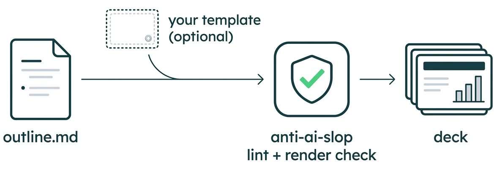

# pitch-deck

<h3 align="center">Turns an <code>outline.md</code> into a <code>.pptx</code> deck that looks like it belongs to <b>your</b> organisation, and doesn't look like AI slop.</h3>

<p align="center">
  
</p>

It builds on your template. Give it a company PowerPoint template and it reads the file: theme fonts and colours, the logo, and every named layout. It works out which layout is the title slide, the section divider, the plain-text slide, the table, the image with text, the closing slide, and so on. Each slide in your outline is then built from the matching real layout, with the template's masters, placeholders, logo and artwork intact, not a hand-drawn imitation.

Without a template, it uses a clean default visual system in your logo's colours. The deck still has to pass the anti-AI-slop rules below, which a linter checks before hand-off.

It acts only on the outline. Writing the outline is a separate step, done by hand or by an agent that reads your documents, papers or code. The skill adds no facts, doesn't reword your text without asking, and doesn't generate images.

## Example

This repo ships one worked example, made by the skill about itself:

- [`docs/decks/outline.md`](../../docs/decks/outline.md) is the outline, written from this project.
- [`docs/decks/PitchDeckSkill_2026-10-19.pptx`](../../docs/decks/PitchDeckSkill_2026-10-19.pptx) is the deck the skill built from it. There was no template, so the skill took the project logo (`cslev_logo.png`) and derived the colour template from it: dark teal for the frame and big-type slides, green as the highlight. The logo is dark, so the title slide is split with the logo on a white panel.

The outline has a short deck section at the top (core message, audience, length, optional template and logo paths), then one section per slide. Each slide can set:

- `Role`: title, divider, content or statement
- `Layout hint`: text, text + visual, table, chart, diagram and so on; the skill picks one if you leave it out
- `On slide`: the exact text to show
- `Visual`: a file path, or a description that becomes an outlined placeholder
- `Chart or table data`: markdown tables that become native charts and tables
- `Source`: the line shown under data
- `Speaker notes`: what to say, plus anything the audience shouldn't see
- `Hidden`: keep the slide in the file but skip it in the show

[`outline-template.md`](outline-template.md) shows the full format.

## What you give it

| Input | Required | Notes |
|---|---|---|
| `outline.md` | yes | Copy [`outline-template.md`](outline-template.md). Per slide: role, assertion title, on-slide text, visual, chart or table data, source, speaker notes. Names, spellings and terms in the outline are used exactly. |
| Template `.pptx` | no | Named by you, in the outline, in the project's `docs/decks/samples/`, or in the skill's own `assets/` (see [Where files go](#where-files-go)). Company templates with real layouts are used layout by layout; a loose example deck gives only its style (fonts, colours, positions, logo). |
| Logo (PNG/JPG) | no | Named by you, in the outline, in `docs/assets/logos/`, or in the skill's `assets/`. Only needed without a template: it sets the brand colours. |

Output goes to `docs/decks/` in your project.

## How it works

1. The skill checks the outline and reports problems: missing roles or titles, chart data without numbers, rule conflicts (each with a proposed fix), and claims the numbers don't support. You accept or decline each fix, and nothing is reworded silently.
2. It analyses the template (`scripts/style_from_reference.py`): fonts, colours, whether the logo is light or dark, and a catalogue of layouts with their guessed role and placeholders. It renders the layouts it plans to use, because layout names can be misleading.
3. It shows a slide-to-layout table for your approval and flags any slide the template has no good layout for.
4. It builds the deck. Text goes into the template's placeholders. Charts and tables are native, editable PowerPoint objects built from the numbers in the outline. Images you describe become labelled placeholders, with the brief in the speaker notes, and image files are placed.
5. It adds a Thank-you slide as the last slide, using the template's closing layout if it has one and a styled slide in the brand colours otherwise. The outline doesn't need to include it.
6. It runs the quality gate: the linter must pass, then the deck is rendered with LibreOffice and every page is checked by eye.

## Anti-AI-slop rules

These rules apply to the deck's copy and to every shape the skill adds. A template's own design is left alone. `scripts/lint_deck.py` enforces them, and a deck that fails it isn't delivered. The full list is in [`reference/deck-style.md`](reference/deck-style.md). A sample:

### Copy

- Titles state the slide's point in 12 words or fewer, in sentence case, with no ending punctuation, no question titles, no "X: The Y of Z" and no series counters
- Claims stay inside the source, with no invented causes or consequences, and data carries a `Source:` line when the origin is known
- No em dashes. Bullets are fragments without periods, at most 5 per slide and about 12 words each
- A banned list of AI vocabulary (seamless, robust, leverage, unlock, comprehensive, "in today's" and more). Novelty is shown with the mechanism or the number
- Slide forms vary: no run of slides with the same bullet shape, no "Key takeaways" filler, and no "not just X, but Y" phrasing

### Visual

- No eyebrow labels above titles, and no badges, pills or text in filled shapes
- No shadows, glows, gradients, rounded boxes, decorative accent bars or stripes
- No icon-card grids, stat-tile dashboards or page-counter chrome
- No emoji, clip art or stock imagery. Icons come from one line-icon set (Lucide) and are used sparingly
- No default AI palettes (purple or indigo, cream with terracotta and a serif). One accent colour, and titles in a single colour
- Charts are native and labelled, not pictures or bars drawn from shapes. No 3D, and no pie charts with more than four slices

### Process

- You approve the outline-to-layout mapping before anything is built
- A final editing pass checks that the titles tell the story, every number traces to the outline, each slide passes an 8-second read, and the deck couldn't be about any other topic by swapping nouns

Terms from your outline win over the vocabulary bans. If your product's name is a banned word, the skill allows it and lists it in the hand-off.

## Using it

To build, say "build the deck from outline.md using template.pptx".

To change one slide, say what you want in plain words:

- "redo slide 13" (after you changed that slide in `outline.md`)
- "update slide 7: add the new latency numbers"
- "change the chart on slide 15 to show X"
- "add a slide after 12 about Y", "delete slide 9", "move slide 5 after 8"

The skill edits the deck file as it is now, including your manual edits. It doesn't regenerate the whole deck, and `scripts/slide_guard.py` checks that the other slides are unchanged. It then reports which slide changed. Slide numbers are positions in the current deck, with hidden slides counted.

## Install

You can install it in either location:

```bash
# for one project: the skill, your template and your outputs live together
cp -r skills/pitch-deck /path/to/your-project/.claude/skills/

# for you, in every project
cp -r skills/pitch-deck ~/.claude/skills/
```

The skill needs `python-pptx`. LibreOffice and poppler (render check) and Pillow (template and logo analysis) are optional. If a tool is missing, the skill skips that step and doesn't install anything for you.

## Where files go

`docs/` always means the project, which is the directory Claude Code was started in. It is not `~/docs` and not a folder inside the skill. The skill creates `docs/decks/` (and `docs/decks/samples/`) there when it first runs.

The skill looks for the template and the logo in this order. The first match wins, and the skill says which one it used:

1. a path you give in the request ("use ~/templates/corp.pptx")
2. the `Template:` and `Logo:` lines at the top of `outline.md`
3. the project: `docs/decks/samples/*.pptx` (the newest) and `docs/assets/logos/`
4. the skill's own `assets/` folder

With a per-project install, put the template in `docs/decks/samples/` and the logo in `docs/assets/logos/`. With a user-level install (`~/.claude/skills/`), the simplest option is to put `template.pptx` and your logo in `~/.claude/skills/pitch-deck/assets/` once. Every project then picks them up, and a project can override them with its own files or paths. If the template is confidential, add `docs/decks/samples/` to the project's `.gitignore`.

## What's in the folder

| Path | Role |
|---|---|
| `SKILL.md` | the workflow Claude follows |
| `outline-template.md` | the outline format to copy |
| `assets/` | optional personal default template and logo for a user-level install |
| `reference/deck-style.md` | copy rules, visual bans, default visual system, quality gate |
| `reference/layout-reuse.md` | analysing a template, mapping slides to its layouts, building from them |
| `scripts/deck_lib.py` | build and edit helpers: template opener, placeholders, native charts, tables, Thank-you slide |
| `scripts/slide_guard.py` | proves an edit touched only the intended slides |
| `scripts/lint_deck.py` | the anti-slop linter: `python3 scripts/lint_deck.py <deck.pptx> --max-words 60 [--template] [--allow TERM ...]` |
| `scripts/style_from_reference.py` | template analysis: fonts, colours, logo, layout catalogue |
| `scripts/logo_palette.py`, `scripts/icon_to_png.py` | brand colours from a logo; Lucide icons for big-type slides |
